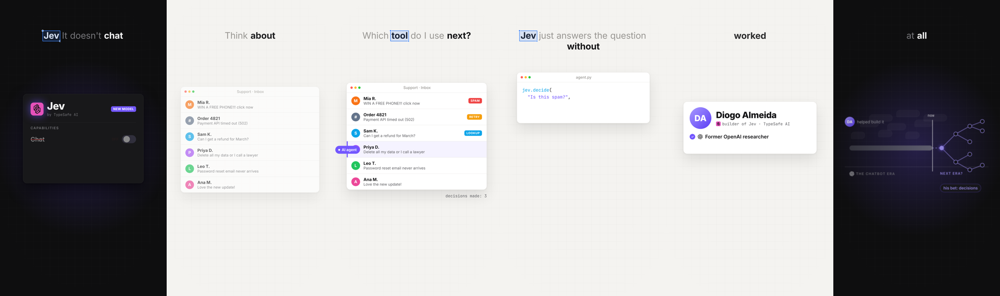

# Explainer Reel Kit

Turn a written script into a vertical animated explainer reel: AI narration, word-by-word subtitles at the top, a different animated visual for every beat, alternating dark and light scenes, real brand logos, a soft music bed with whooshes, and a finished 1080x1920 MP4 under 29 MB.



You write the script. A coding agent (Claude Code, Codex, Cursor) writes the animation for each video using the skill file in this repo, checks its own frames, and renders the final MP4.

## What's inside

| Path | What it is |
|---|---|
| `PROMPT.md` | The prompt to paste into your coding agent, plus the script format |
| `skill/animated-explainer-reel/SKILL.md` | The full style and workflow spec the agent follows |
| `engine/narrate.py` | Text to speech (Kokoro) plus word timings (faster-whisper) |
| `web/engine.js`, `web/index.html` | The frame-by-frame animation engine and subtitle renderer |
| `web/render.py` | Renders contact sheets, stills and the full video with headless Chromium |
| `web/finish.py` | Music bed, whooshes, voice mix, -14 LUFS loudness, final MP4 |
| `web/logos/` | 115 real brand logo files with a lookup helper (`docs/logos.png` shows them) |
| `web/fonts/` | Inter and JetBrains Mono, bundled so renders match on any machine |
| `web/v02.js`, `videos/v02.py` | Approved example: "Are we overpaying for Claude" |
| `web/v20.js`, `videos/v20.py` | Example with real photos and video clips: the Tesla Roadster reel |
| `scripts/` | The scripts for both examples |
| `tools/timing.py` | Prints every line with word times for storyboarding |

## Setup (once)

You need Python 3.10 or newer, ffmpeg, and about 1 GB of disk for the voice and alignment models.

```
git clone https://github.com/jriizzyy/explainer-reel-kit.git
cd explainer-reel-kit
./setup.sh
```

On Windows, run the commands inside `setup.sh` one by one in PowerShell, or use WSL.

Check it works by rendering stills of the example:

```
python3 web/render.py v02 stills 3 14 24 33 47 58
```

Open `build/v02w/stills.png`. It should look like the frames above.

## Make a video

1. Write your script in `scripts/` using the format in `PROMPT.md`.
2. Open the repo in your coding agent and paste the prompt from `PROMPT.md`.
3. The agent writes the narration spec, generates the voice, storyboards against the word timings, writes the animation, checks stills until nothing is clipped or static, and renders `out/<name>.mp4`.

To install the skill so your agent loads it automatically, copy `skill/animated-explainer-reel` into your agent's skills folder (for Claude Code that is `~/.claude/skills/`).

## Doing it by hand

```
python3 -m engine.narrate v30                 # voice + timings -> build/v30/
python3 tools/timing.py v30                   # word times to plan against
# write web/v30.js (start by copying web/v02.js)
python3 web/render.py v30 sheet 0 60 2        # one frame every 2 s -> build/v30w/sheet.png
python3 web/render.py v30 stills 4.2 9.8      # exact moments -> build/v30w/stills.png
python3 web/finish.py v30 "30 - My Video"     # -> out/30 - My Video.mp4
```

Voice and speed can be changed with `REEL_VOICE` (default `af_heart`) and `REEL_SPEED` (default `1.08`).

## Real footage

`web/v20.js` shows how to mix real clips into scenes. Its five clip slots (`kickflip`, `ramp`, `live`, `r2017`, `gta`) are empty in this repo because the footage belongs to Tesla and Rockstar. The video still renders, with animated stand-ins in those slots. To use your own clips:

1. Trim and convert to VP9 WebM (Chromium in the renderer can't play H.264):
   `ffmpeg -ss 00:30 -to 00:43 -i source.mp4 -vf "scale=1080:-2,fps=30" -an -c:v libvpx-vp9 -b:v 0 -crf 32 -row-mt 1 clip.webm`
2. Put it in `web/media/<topic>/clips/` and run `python3 web/mkmedia.py`.
3. Set the in-point so the key moment lands on the right word (see `CLIPIN` in `web/v20.js`).

## Rules the style follows

- Every brand mentioned uses its real logo; mockups of real products are labeled "recreation"; invented numbers are labeled "illustration"; company claims are attributed on screen.
- No personal info, real emails or share links on screen.
- No em dashes on screen.

## Rendering speed

Rendering screenshots every frame, so a 2-minute reel takes a while on a laptop. More CPU cores help: change the worker count in `web/finish.py` (`main(vid, name, workers=2)`).

See `NOTICE.md` for fonts, logos and photo credits.
